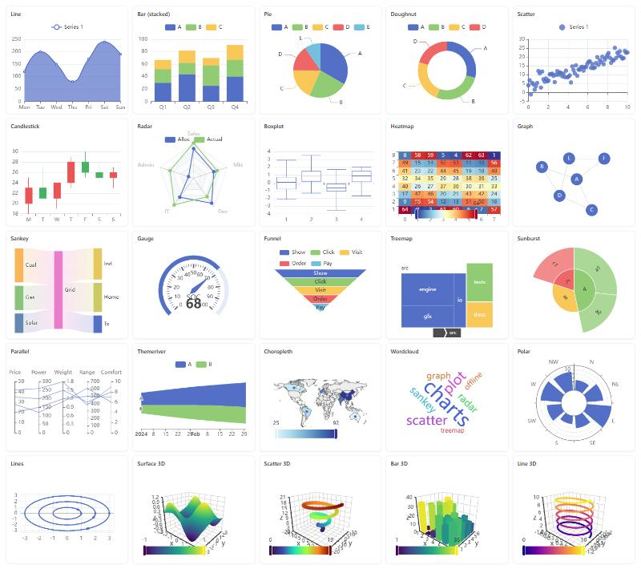

# echarts

Interactive charts for [Nelson](https://nelson-lang.github.io/nelson-website/)
using [Apache ECharts](https://echarts.apache.org/). An object-oriented binding
that renders live charts in the WebView / WebAssembly desktop and exports
self-contained HTML elsewhere. The ECharts library is bundled in the module, so
charts render without network access.

```matlab
echarts.bar({'Q1', 'Q2', 'Q3', 'Q4'}, [128 196 143 205]) ...
  .title('Quarterly revenue') ...
  .ylabel('k EUR') ...
  .show();
```

## Gallery



Twenty-five chart types, including 3D surface, bars, scatter and line via
echarts-gl, all rendered from the bundled library. The code for each one is in
the [`examples/`](examples) folder.

## Install / load

With the module manager:

```matlab
nmm('install', 'echarts')   % once published
```

Or load it in place from a clone:

```matlab
run('/path/to/echarts/loader.m')
```

## Chart types

One factory per chart type. Each returns an `echarts.chart` that you refine with
the setter methods, then `show()` or `save()`.

| Family | Factories |
| --- | --- |
| Cartesian | `bar` `line` `area` `scatter` `bubble` `effectScatter` `plot` `stem` `hist` `pictorialBar` `lines` |
| Part-to-whole | `pie` `doughnut` `funnel` `gauge` `radar` `polar` |
| Statistical | `boxplot` `candlestick` `heatmap` `calendar` |
| Relational / hierarchical | `graph` `tree` `treemap` `sunburst` `sankey` `parallel` `themeRiver` |
| Geo | `map`, `choropleth` (bundled world map) |
| 3D (echarts-gl) | `surface` `bar3D` `scatter3D` `line3D` |
| Extensions | `wordcloud` (bundled echarts-wordcloud) |
| Escape hatches | `chart` (empty), `fromOption` (a full ECharts option), `fn` (inject JavaScript) |

The factories cover the ECharts series types one to one. Anything in the gallery
is reachable through a factory, or through `fromOption` for a hand-written
option.

## The fluent API

Every setter returns the chart, so calls chain:

```matlab
echarts.line(1:12, cumsum(randn(1, 12)), 'Names', {'signal'}) ...
  .title('Random walk') ...
  .smooth(true) ...
  .area(true) ...
  .dataZoom('x') ...
  .toolbox() ...
  .theme('dark') ...
  .show();
```

The setters group into:

- Data and series: `addSeries`, `labels`, `stack`, `smooth`, `area`,
  `horizontal`, `logscale`, `yaxis2`.
- Display: `title`, `subtitle`, `legend`, `xlabel`, `ylabel`, `grid`, `colors`,
  `dataLabels`, `theme`, `animate`.
- Interaction: `tooltip`, `toolbox`, `dataZoom`, `visualMap`.
- Annotations: `markLine`, `markArea`, `markPoint`, `hline`, `vline`, `xregion`,
  `yregion`, `labelAt`.
- Fitted overlays: `trendline`, `movingAverage`.

For options without a dedicated setter, `option('dotted.path', value)` reaches
any ECharts option, and `echarts.fn('(p) => ...')` injects JavaScript for
formatters, scriptable colors and symbol sizes.

## Display and export

`show()` chooses the display for the session:

- WebView / WebAssembly desktop: the chart is embedded in a UI figure and
  refreshes in place. `update`, `append` and `push` stream data; `onClick`,
  `onHover` and `onLegendClick` report interaction; `saveImage`, `copyImage` and
  `print` export it.
- Qt desktop: a self-contained page in the HTML viewer.
- Terminal: the page opens in the system browser.

Export without a display:

```matlab
c = echarts.pie({'A', 'B', 'C'}, [30 45 25]).title('Share');
c.save('share.html', 'Width', 800, 'Height', 500);   % offline HTML
txt = c.json('pretty', true);                        % the ECharts option as JSON
```

## The bundled library

The ECharts core is under `thirdparty/` and inlined into every page, so charts
render with no network access. The `'cdn'` library source loads from jsDelivr
instead, and `echarts.vendor()` refreshes the bundled copy. The optional
extensions (`gl` for 3D, `wordcloud`) and the world map are bundled as well.

```matlab
c.show('Library', 'cdn');          % load ECharts from the CDN
echarts.vendor();                  % re-download the core library
echarts.vendor('wordcloud');       % re-download an extension
```

## Examples

The [`examples/`](examples) folder holds 392 runnable examples covering every
category: line, bar, pie, scatter, candlestick, radar, boxplot, heatmap,
calendar, graph, tree, treemap, sunburst, sankey, funnel, gauge, parallel, theme
river, pictorial bar, polar, lines, geo maps, and 3D (surface, bar, scatter,
line). It also includes feature demos: dark theme, data zoom, toolbox, mark
lines and areas, visual maps, gradients, dataset, live streaming and HTML
export. Each is listed with a bilingual title in
[`examples/index.json`](examples/index.json).

## License

LGPL-3.0-or-later. Apache ECharts and the bundled extensions and map data keep
their own licenses. See [THIRDPARTY.md](THIRDPARTY.md).
